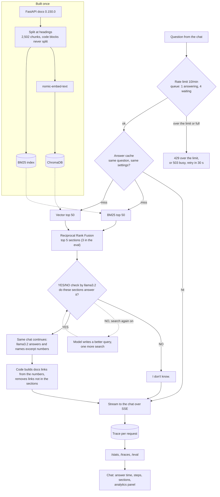

# Pinpoint

Pinpoint answers FastAPI questions only from the FastAPI docs, links the exact section it used, and says "I don't know" when the docs don't cover it. It runs locally on a 4 GB GPU with Ollama and is evaluated on real questions from FastAPI's GitHub Discussions.

A wrong answer with a real-looking docs link costs a developer more time than "I don't know", so every design choice here favors being right or silent over being helpful-sounding, and every claim is measured.

1. **Grounded links:** the model never writes URLs. It names excerpt numbers and code builds the links, so every link points to a section that was actually retrieved.
2. **Honest refusals:** on 22 held-out questions the docs don't cover, it says "I don't know" to 15. Without its YES/NO check it says it to none.
3. **The price, stated openly:** only 6 of 28 held-out docs questions get the right page cited. Every failure is counted and explained below.
4. **Measured, not tuned to the test:** 350 real GitHub Discussions questions, a frozen dev/test split, all tuning on dev, and the 50 test questions scored only twice: before the speed work and on the final setup.
5. **Built like a service:** streaming with cancel, a trace per request, a queue that answers "busy" instead of slowing everyone down, a rate limit, an injection guard (0 of 5 attacks got through), and CI that fails if retrieval gets worse.
6. **Fast on small hardware:** p50 latency on dev went from 22.8 s to 8.2 s on a 4 GB GPU, with 43 passes vs 44 before.

Stack: Python, FastAPI, Ollama (`llama3.2` 3B, `nomic-embed-text`), ChromaDB, hand-written BM25, React + Vite + Tailwind chat, pytest, Docker, GitHub Actions.

Every number here comes from a script and a result file in `evals/`.

## Architecture

1. The model never writes URLs. It returns excerpt numbers and code turns them into links, so every cited page exists and was actually retrieved.
2. Answers stream to the chat over Server-Sent Events, and closing the page stops the model.
3. Each request saves a trace: retrieved chunks, time per step, and tokens and timings for every model call. The chat shows the answer time under each reply, which opens that trace's steps and found sections, and a side panel shows the test results from `/eval` and live numbers from `/stats`.
4. The eval calls the same `answer()` function as the API. The scored runs use the top 3 excerpts; the chat uses 5, which puts the right page in front of the model for 29 instead of 25 of 40 dev docs questions at about 3 s more per answer.
5. CI runs on every push: ruff, pytest, a Docker build, and a retrieval check that needs no model. It rebuilds the chunks and fails if BM25 finds the right page in the top 3 for fewer than 17 of 40 dev docs questions (18 today). A manual workflow runs 20 dev questions through Ollama on a CPU runner and fails below 9 passes. The first run passed 11 of 20, the same as on the GPU, at a p50 of 32.3 s per question, and took 33 minutes including 18 minutes to build the index.

## Results

The evaluation set is 350 answered questions from GitHub Discussions, each tagged as answered by the docs or not. A frozen split keeps 80 dev questions for all tuning and 50 test questions (28 docs, 22 out of scope). The test set was scored twice: before the speed work (27 passes) and on the final setup (21 passes). The speed changes were decided on dev before the second test run and kept after it, so the test numbers below are the final setup's and weren't tuned on.

1. **Safety:** on the 22 held-out questions the docs don't cover, Pinpoint says "I don't know" to 15. Without the YES/NO check it says it to none.
2. **Speed:** p50 latency on dev went from 22.8 s to 8.2 s, and p95 from 53.5 s to 18.9 s, with 43 passes vs 44 before.
3. **Cost of safety:** only 6 of 28 held-out docs questions get the right page cited. The check refuses many answerable questions (see Limitations).

**Model alone vs Pinpoint**, 20 docs questions graded by hand. These grades come from an earlier setup (5 excerpts, separate check and answer calls) and weren't redone after the speed work:

| | Model alone | Pinpoint |
|---|---|---|
| Correct | 0 | 3 |
| Partly right | 5 | 4 |
| Wrong | 12 | 1 |
| "I don't know" | 3 | 12 |

**With and without the YES/NO check**, 50 held-out test questions:

| | No check | With check (final) |
|---|---|---|
| Passed | 14 | 21 |
| Docs: cited the right page | 14 / 28 | 6 / 28 |
| Out of scope: said "I don't know" | 0 / 22 | 15 / 22 |
| p50 latency | 10.4 s | 9.6 s |

The check trades docs answers for safety: it stops most made-up answers but also refuses some answerable questions. Per question it wins 15 and loses 8 (p = 0.21), so on 50 questions the overall gain isn't significant.

## Load

`scripts/load_test.py` calls `answer()` from 1, 2 or 4 clients at once, with the answer cache off and 12 different dev questions per round. Results are in `evals/load_*.json`.

| Clients at once | Answers/min (Ollama 1 / 2 at a time) | p50 | p95 |
|---|---|---|---|
| 1 | 6.6 / 5.1 | 7.4 s / 9.7 s | 16.6 s / 20.9 s |
| 2 | 6.6 / 5.1 | 13.1 s / 15.5 s | 41.2 s / 63.2 s |
| 4 | 5.6 / 4.5 | 38.6 s / 47.7 s | 59.6 s / 77.2 s |

1. One 4 GB GPU gives about 6.6 answers a minute however many clients ask. More clients only wait longer. There were 0 errors in 72 requests.
2. Ollama running 2 requests at once still fits on the GPU, but it was about 20% slower at every load, so Ollama runs 1 at a time (`OLLAMA_NUM_PARALLEL=1`).
3. The API runs 1 answer at a time with 4 more waiting. A 6th request at the same moment gets `503` with `Retry-After: 30`, so overload gives a clear "busy" instead of every user slowing down. The last one in a full queue waits about 45 s.
4. A load test must never repeat questions. Ollama keeps a prompt cache, and a prompt it has seen before is read in 0.02 s instead of about 6 s. A first run that reused questions showed over 50 answers a minute.
5. 10 or 11 of the 12 questions in each round ended in "I don't know", which skips the answer step, so traffic with more answerable questions will be a little slower.

## Problems and fixes

1. **Answering everything.** With retrieval, the model answered every question, even ones the docs don't cover (0 of 20 "I don't know"). A YES/NO check on the retrieved sections now runs first, and 15 of 22 out-of-scope test questions get "I don't know".
2. **Unreliable citations.** The model skipped `[2]`-style citations, and JSON output broke on quotes inside code. It now writes an `EXCERPTS: 2, 4` line and code builds the links, so every link is real and was retrieved.
3. **Silently cut chunks.** The embedder drops text past 2,048 tokens, which hit 18 chunks, 15 of them on answer pages. Sections are now split at 1,500 characters, never inside a code block.
4. **2 s lost on every Ollama call.** On Windows `localhost` tries IPv6 first. Requests now go to `127.0.0.1`, saving about 6 s per question.
5. **Model reloads.** Ollama unloaded the model after 5 idle minutes, and reloading took 4 to 13 s. Requests now ask Ollama to keep it loaded.
6. **The same prompt read twice.** The check and the answer each read the same long prompt. The answer is now a follow-up turn in the check's chat, so Ollama reuses what it read, and answer reading dropped from about 7 s to under 1 s.
7. **GPU memory.** `llama3.2` and the embedder didn't fit on the GPU together. `llama3.2` is pinned to the GPU and question embeddings run on the CPU, which cut answer time from 25.4 s to 15.0 s.
8. **Cancelled requests.** Closing the page left Ollama writing and lost the trace. A worker thread now watches a cancel flag, closes the Ollama stream and saves the trace; Ollama stops 1.1 s after the page closes.
9. **Prompt injection.** Forum posts can carry instructions. Citations are by number only, answer links may only come from the excerpts, and answers render as plain text. 0 of 5 injection attacks got through.
10. **Excerpt numbers in answers.** The model wrote phrases like "as shown in Excerpt 4", which mean nothing to a reader. Code now removes them. Answers saved before the fix kept coming back from the answer cache, so the cleanup rule is now part of the cache key.
11. **Weak links.** Release-notes chunks match many questions, and the model sometimes cites them instead of the tutorial page the answer came from. The chat never shows release-notes links, and when they were the only citation it says to check the answer in the docs; the trace still lists every section found.

## Decisions and trade-offs

Each row is a choice, what it bought, what it cost, and why it stayed. What was tried and not kept is in the next section.

| Choice | Gain | Cost | Why it was kept |
|---|---|---|---|
| YES/NO check before answering | Out-of-scope "I don't know" 0 → 15 of 22 on test | Docs questions cited 14 → 6 of 28 | A wrong answer with a real-looking docs link is worse than "I don't know" |
| Top 3 excerpts instead of 5 | About 600 fewer prompt tokens, about 3 s faster per question | Right page in front of the model for 25 instead of 29 of 40 dev docs questions; test passes 27 → 21 (p = 0.11) | Kept for the scored runs: decided on dev (passes 44 → 43, p = 1.0) before the test run, and changing it after seeing test results would be tuning on the test set. The chat uses 5, trading about 3 s for more first-try answers |
| Answer as a follow-up turn in the check's chat | Ollama reuses the prompt it already read; answer reading under 1 s | The check prompt can't be reworded to suit both steps | Rewording the check broke it (see below) |
| Local 3B model instead of a hosted one | Free, private, no request limits, so full eval runs are possible | Weaker judgement and a latency floor set by reading speed | Scored numbers need repeatable full runs; a hosted model (Gemini) stays as a demo option |
| "Search again" agent off by default | Keeps latency and out-of-scope refusals where they are | Loses a second chance for missed pages | It didn't raise docs answers on dev (see below) |
| In-memory rate limit | No extra service to run | Only works for one process | One process is all this needs |
| Questions of 3 to 20,000 characters | Junk like "hi" never takes a queue slot or a ~4 s check; huge pastes can't push the 5 sections out of the model's 8,192-token context | A greeting can't be sent, and the chat greys out Send until 3 characters | With 1 answer at a time and 4 waiting, a few junk messages could make real users wait or get "busy" |
| 1 answer at a time, 4 waiting, then 503 | Steady speed; overload gets a clear "busy" | About 6.6 answers a minute; a 6th user at once is turned away | The GPU can't do more, and 2 at once was slower |

## Tried and dropped

All measured on dev, most against a pass mark written down before the run. Each one looked like an obvious improvement and the numbers said no.

1. **Distance cutoff for "I don't know".** The median closest-chunk distance was 0.201 for docs questions and 0.210 for the rest, so a cutoff can't separate them.
2. **Cross-encoder reranker** (`ms-marco-MiniLM-L6-v2`). Top-5 hits fell from 29 to 25 of 40, and it added about 2.7 s. It's trained on short web queries, not long forum posts with code.
3. **MMR for more varied results.** hit@5 went from 0.72 to 0.78, but with 5 better and 3 worse (p = 0.73) that's no real gain.
4. **Looser check wording** ("fully or in part"). The check said YES to two thirds of the out-of-scope questions.
5. **One system prompt for check and answer.** Passes fell from 44 to 33, because the check stopped refusing out-of-scope questions.
6. **Stricter check** ("name the excerpt", or `qwen2.5:3b` as judge). It said YES to 0 of 30 docs questions that had the right page, so it was far too strict.
7. **Skipping release-notes chunks.** Out-of-scope "I don't know" rose from 34 to 36, but docs passes fell from 9 to 8, and a fresh sample missed its bar by one.
8. **One chunk per page.** Search hits rose from 25 to 30 of 40, but passes fell from 43 to 39, because the check refused more found pages and answered more out-of-scope ones.
9. **Quote check for faithfulness.** A real quote didn't mean a right answer: 5 of 8 right answers had one, and so did 6 of 13 wrong ones.
10. **"Search again" tool-calling agent.** Docs answers stayed at 9 of 40, out-of-scope "I don't know" fell from 34 to 30, and p50 went from 8.2 s to 13.5 s. It's kept as an option, off by default.
11. **Automatic graders.** `llama3.2` agreed with the hand grades on as few as 1 of 8 answers. `gemini-3.6-flash` gave the same correct / partly / wrong grade on 11 of 22 (2 of 8 for Pinpoint's answers), so it could no longer reach the 80% mark set before the run, and the last 3 weren't judged.
12. **`qwen2.5:3b` as the answer model.** It cited nothing on the first 6 questions tried.
13. **Gemini free tier for the eval.** It allows 20 requests per day per model, but one dev run needs 80 to 160.
14. **Trained YES/NO gate** (logistic regression on the question embedding, trained on 136 extra out-of-scope questions plus dev in 5 folds). Its scores barely separated docs from out-of-scope questions (AUC 0.55, where 0.5 is a coin flip). It said YES to 10 of 40 docs questions, and passes fell from 43 to 39. With no check at all, the model cites the right page for 22 of 40 docs questions, so the hard part is telling the two kinds apart, not answering.

## Limitations

1. It answers few docs questions: 6 of 28 on test. Search misses the right page for 13, the check refuses 8 where the right page was shown, and 1 cites the wrong page. The 3B check is the main limit.
2. Small samples (50 test, 80 dev) and a single human grader, so most differences are noise.
3. Answers aren't always faithful: only 3 of 12 hand-checked answers were fully backed by the excerpts.
4. A 3B model on a 4 GB GPU. Reading speed sets the floor on latency.
5. The rate limit and the answer queue live in one process's memory, the injection probe is only 5 attacks, and `docker compose up` hasn't been run end to end.
6. The chat has no memory between messages. Each question is searched on its own, so a follow-up like "how do I use it?" gets "I don't know".

## Future scope

1. A bigger model for the check. The right page is in the top 10 for 32 of 40 dev docs questions, but only 9 get cited. A trained gate on the question alone couldn't tell docs from out-of-scope questions (AUC 0.55), so the check needs a model that reads the excerpts, such as a 7B+ model on a larger GPU or a paid hosted one.
2. After that, send more excerpts and one chunk per page. That raised search hits from 25 to 30 of 40 on dev, but the current check couldn't use them.
3. Run the eval on a hosted model. The Gemini client already works, but the free tier is too small for an eval run.
4. More questions and a second grader, so differences can become significant.
5. Run `docker compose` end to end, and move the rate limit to shared storage such as Redis to support more than one process.
6. A GitHub Discussions helper that drafts an answer with docs links for each new question, for a maintainer to review before posting.
